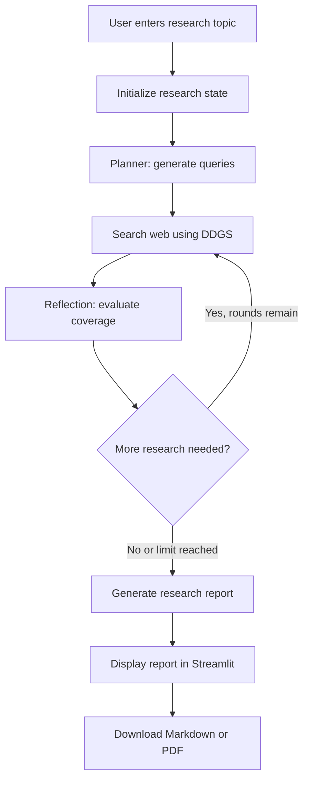

# Agentic Research Assistant

An AI-powered research application that plans web searches, collects search-result evidence, evaluates research coverage, and generates structured reports with source links. Built with Python, LangGraph, Groq, DDGS, and Streamlit.

## Overview

Traditional LLM applications often answer a question in a single generation step. This project uses a multi-step workflow to break research into smaller tasks, retrieve web results, reflect on information gaps, and synthesize a report.

The workflow uses LangGraph to manage state, execute nodes, and control conditional routing. Users interact with the application through a Streamlit interface and can download reports in Markdown and PDF formats.

## Features

- **Automated research planning:** Generates three initial search queries from a user-provided topic.
- **Web search:** Retrieves titles, URLs, and snippets using DDGS.
- **Iterative research:** Evaluates research coverage and can request additional searches.
- **Bounded execution:** Limits the workflow to a maximum of three search rounds.
- **Error handling:** Includes search retries and fallback behavior for several LLM and report-generation failures.
- **Progress visibility:** Displays workflow-node updates and research logs in Streamlit.
- **Source-linked reports:** Generates a structured Markdown report with numbered source references.
- **PDF export:** Converts the generated report into a downloadable PDF using ReportLab.
- **Dependency management:** Uses `uv` for Python environment and dependency workflows.

## Technology Stack

| Technology | Purpose |
|---|---|
| Python | Core application logic |
| LangGraph | Workflow orchestration, shared state, and conditional routing |
| LangChain Groq | Integration with a Groq-hosted language model |
| Groq | LLM inference for planning, reflection, and report generation |
| DDGS | Web search and retrieval of search-result snippets |
| Streamlit | User interface and progress display |
| ReportLab | PDF generation |
| python-dotenv | Loading configuration from `.env` |
| uv | Python dependency and environment management |

## Architecture

The application consists of two main modules.

### 1. `agent.py` — Research Workflow

The research workflow is implemented as a LangGraph state graph.

**Planner → Search → Reflection → Conditional Routing → Report Writer**

1. **Planner:** Uses the LLM to generate three focused search queries.
2. **Search:** Executes queries through DDGS and collects unique URLs, titles, snippets, and originating queries.
3. **Reflection:** Evaluates the retrieved evidence and decides whether further research would be useful.
4. **Conditional routing:** Returns to the search node when more research is requested and the search-round limit has not been reached.
5. **Report writer:** Generates a structured Markdown report with source identifiers and a source list.

The workflow maintains a shared state containing the research topic, queries, accumulated results, report, loop counter, logs, and reflection decision.

### 2. `app.py` — User Interface and Export

The Streamlit application provides:

- Research topic input.
- A Start Research button.
- Workflow progress and logs.
- Final report display.
- Markdown download.
- PDF generation and download.

ReportLab handles PDF formatting, including supported headings, paragraphs, lists, tables, links, and page numbers.

## Workflow Diagram



## Project Structure

```text
AgenticResearchAssistant/
├── agent.py
├── app.py
├── requirements.txt
├── .env
├── .env.example
├── .gitignore
└── README.md
```

- `agent.py`: Research nodes, state definition, routing, and compiled graph.
- `app.py`: Streamlit UI, progress display, PDF generation, and downloads.
- `requirements.txt`: Python dependencies.
- `.env`: Local configuration and API key; must not be committed.
- `.env.example`: Example configuration without real secrets.
- `.gitignore`: Excludes secrets, virtual environments, and generated files.
- `README.md`: Project documentation.

## Prerequisites

- Python version compatible with the installed dependencies.
- `uv` installed.
- A Groq API key.
- Internet access for Groq inference and web searches.

## Installation and Setup

### 1. Clone or open the project

Open the project directory in VS Code and use its terminal.

### 2. Create a virtual environment

```powershell
uv venv
```

Activate it in PowerShell if you want to use the environment explicitly:

```powershell
.\.venv\Scripts\Activate.ps1
```

### 3. Install dependencies

```powershell
uv pip install -r requirements.txt
```

The `requirements.txt` file should contain:

```text
langgraph
langchain-groq
ddgs
streamlit
python-dotenv
reportlab
```

### 4. Configure environment variables

Create a `.env` file in the project root:

```dotenv
GROQ_API_KEY=your_groq_api_key
GROQ_MODEL=openai/gpt-oss-120b
```

Replace the placeholder with your actual API key. Do not share the key or commit `.env` to version control.

The model identifier must be available to your Groq account. If it is unavailable, configure a supported model in `GROQ_MODEL`.

### 5. Run the research agent independently

```powershell
uv run python agent.py
```

Enter a research topic when prompted. This allows you to test the workflow without the Streamlit interface.

### 6. Launch the web application

```powershell
uv run streamlit run app.py
```

Open the local URL shown in the terminal, usually:

`http://localhost:8501`

Enter a topic, start research, inspect the report, and test both download options.

## Configuration

| Setting | Description |
|---|---|
| `GROQ_API_KEY` | API key used for Groq inference |
| `GROQ_MODEL` | Model identifier used by `ChatGroq` |
| `MAX_LOOPS` | Maximum number of research rounds; currently 3 |
| `MAX_RESULTS_PER_QUERY` | Maximum search results requested per query; currently 5 |
| `SEARCH_RETRIES` | Number of attempts per search query; currently 2 |

The numeric settings are currently defined in `agent.py`.

## Error Handling

The application includes several safeguards:

- Failed web searches are retried.
- Search failures are logged, and other queries can continue.
- Planner failures trigger fallback queries.
- Reflection failures stop further research and proceed with the evidence already collected.
- Report-generation failures produce a fallback evidence summary when results exist.
- PDF-generation errors are displayed without removing the Markdown download option.

These safeguards improve resilience but do not guarantee that every topic will produce a complete or accurate report.

## Limitations

- **Search snippets rather than full pages:** The current search node primarily uses snippets returned by DDGS. It does not systematically fetch and parse the full contents of source webpages.
- **Citation verification:** The report includes retrieved source URLs and numbered references, but claims are not independently verified against the original pages.
- **Heuristic reflection:** The LLM decides whether research is sufficient based on a prompt. This is not a formal completeness or factuality check.
- **Query history:** URL deduplication is implemented, but there is no dedicated persistent history of every query attempted across rounds.
- **Markdown compatibility:** PDF generation supports common Markdown patterns, not every possible Markdown feature. Complex tables, nested lists, and unsupported Unicode characters may need additional handling.
- **External dependencies:** Execution depends on network availability, Groq service availability, model access, and DDGS search behavior.

Generated reports should be treated as research starting points. Verify important claims against the original sources before relying on them.

## Future Improvements

Potential next steps include:

1. Fetch and extract full webpage content.
2. Improve source credibility assessment and content-level deduplication.
3. Validate each factual claim against retrieved evidence.
4. Use structured output schemas for planning and reflection.
5. Add automated tests for state transitions, search failures, and report generation.
6. Benchmark report quality, citation correctness, latency, and cost.
7. Improve progress reporting and add structured execution traces.
8. Improve PDF typography, Unicode coverage, and complex table rendering.

## Security

- Store API keys in environment variables or a secrets manager.
- Exclude `.env`, virtual environments, and other sensitive configuration from Git.
- Treat retrieved webpage content as untrusted input.
- Avoid logging API keys or sensitive user information.

## License

No license has been specified yet. Add a license before distributing or accepting contributions to the project.
